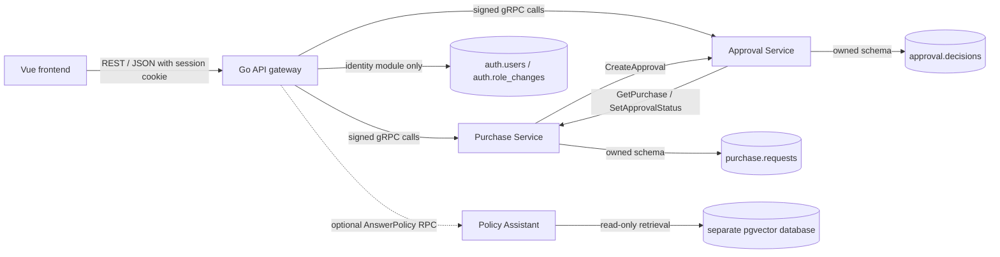

# ProcureFlow AI

A fullstack procurement portfolio application built with **Go, Vue 3, TypeScript and PostgreSQL**. Employees submit purchase requests, managers review approvals, and admins manage user roles. A separate, optional policy assistant answers questions from fictional procurement documents.

The project demonstrates REST and gRPC interfaces, service-owned data, retry-safe workflows, authentication, automated checks, and local container deployment. All records and policies are fictional demo content.

## Implemented features

- Purchase requests with validation, exact integer-cent calculations, and duplicate-safe creation.
- Approval/rejection workflows with idempotent decisions and cross-service status propagation.
- Responsive Vue dashboard with purchasing forms, filters, refresh, and loading/error states.
- PostgreSQL user accounts, employee signup, password hashing, and session-based login/logout.
- Admin user management with employee/manager/admin role assignment, role-change audit records, and last-admin protection.
- HttpOnly cookies, CSRF checks, ownership enforcement, and signed internal gRPC identities.
- PostgreSQL persistence, versioned migrations, structured logs, deadlines, health checks, and graceful shutdown.
- Docker Compose deployment and GitHub Actions configuration for testing and builds.
- Optional read-only policy RAG with pgvector retrieval, source references, and explicit **Not configured** behavior.

The core application needs **no AI API key or model**. The optional assistant has tests using fake providers and real pgvector; live OpenAI integration remains unverified.

## Technology stack

- **Backend:** Go, `net/http`, gRPC, Protocol Buffers.
- **Frontend:** Vue 3 Composition API, TypeScript, Vite.
- **Persistence:** PostgreSQL and pgxpool; pgvector in the optional AI database.
- **Authentication:** Argon2id password hashes, opaque server-side sessions, signed internal JWT claims.
- **Local deployment:** Docker Compose, multistage Go images, unprivileged Nginx frontend.
- **Verification:** Go unit/integration tests, Vitest component/API tests, TypeScript checks, production builds, PowerShell smoke scripts.

## Architecture



Procurement data stays behind its owning gRPC service. The gateway accesses only its own `auth.*` tables for identity operations, using `AUTH_DATABASE_URL`; it never queries purchase or approval tables. The procurement services use `DATABASE_URL`. Compose shares one PostgreSQL instance for these three schemas and keeps optional AI storage separate.

Business logic depends on Go interfaces, so tests can use concurrent in-memory repositories. Runtime user accounts always use PostgreSQL. Protocol Buffer definitions and generated Go stubs are versioned in the repository. See [the architecture guide](docs/architecture.md).

## Quickstart with Docker Compose

Run from the repository root in PowerShell with Docker Desktop using **Linux containers** and Docker Compose v2. Host Go 1.26+ is needed for the credential setup commands below; [Docker-only credential setup](docs/authentication.md#fresh-installation) is available if Go is not installed. Host Node and PostgreSQL are not needed for the Compose deployment.

```powershell
# Fresh installation: generate local credentials once.
# Existing installation: add only the missing initial admin files.
if (-not (Test-Path secrets/auth-users.json)) {
    go run ./cmd/auth-setup
    if ($LASTEXITCODE -ne 0) { throw 'Credential setup failed; inspect existing files' }
} elseif (-not (Test-Path secrets/admin-account.json)) {
    go run ./cmd/auth-setup -admin-only
    if ($LASTEXITCODE -ne 0) { throw 'Admin setup failed; inspect existing files' }
}

docker compose config --quiet
if ($LASTEXITCODE -ne 0) { throw 'Invalid Compose configuration' }
docker compose up -d --build --wait
if ($LASTEXITCODE -ne 0) { throw 'Compose startup failed' }
docker compose ps -a
```

Open **http://localhost:5173/**. The browser API is **http://localhost:8080**. Only these loopback ports are published; PostgreSQL and internal gRPC ports remain private.

Compose applies migrations, runs the insert-only `auth-seed` bootstrap, and waits for health checks before starting the frontend. **Exited (0)** for `migrate` and `auth-seed` means those one-shot jobs completed successfully. Existing SQL passwords, assigned roles, employee IDs, and purchases are preserved on subsequent starts.

The default database settings in [.env.example](.env.example) are public **DEVELOPMENT-ONLY** values. Compose reads an optional root `.env` automatically and uses the `COMPOSE_` settings for local database/port overrides. Credential generation refuses to overwrite existing files. If a file set is incomplete, inspect it rather than deleting files or regenerating the signing key.

```powershell
# Inspect logs:
docker compose logs --tail 100 migrate auth-seed api-gateway purchase-service approval-service

# Stop and remove containers/networks while retaining database storage:
docker compose down

# Resume with the same named volume and existing credentials:
docker compose up -d --wait
```

Keep the named volumes and ignored `secrets/` directory. Do not use `docker compose down -v` for routine shutdown. See [the Docker guide](docs/docker.md) for port overrides, Docker-only setup references, networking, and persistence checks.

## Accounts and roles

Select **Create an account** on the login screen to register with a fictional display name, username, and password. New accounts always receive the **employee** role. They choose their own passwords; signup accounts are stored in SQL and are not appended to local credential files.

- **Employee:** create requests and view only their own purchases.
- **Manager:** view all purchases and approve/reject other people's requests.
- **Admin:** manager permissions plus **Manage users**, where roles can be assigned.

Managers and admins cannot decide their own requests. Admins can assign employee, manager, or admin access, but cannot demote the last admin. Role changes are audited in `auth.role_changes` and invalidate the affected user's old sessions on the next HTTP request.

Initial demo usernames are `employee.demo`, `employee.two`, `manager.demo`, and `admin.demo`. View their generated passwords privately in:

- `secrets/demo-credentials.json` for the employee/manager accounts.
- `secrets/admin-credentials.json` for the admin account.

There is no shared default password. These files are ignored by Git and excluded from image builds. SQL's `auth.users` table is the account source of truth; editing bootstrap JSON does not change an existing SQL password or role.

Sessions last up to eight hours and remain in gateway memory. Restarting the gateway signs users out; SQL accounts, roles, and orders persist. Full setup, validation rules, bootstrap behavior, and security limits are in [the authentication guide](docs/authentication.md).

## Try the procurement workflow

1. Sign in as an employee and submit an item, quantity, and EUR unit price. Employee ID is bound to the signed-in account.
2. Sign out, then sign in as a manager or admin. Select **Review** on another user's PENDING request and approve or reject it.
3. Refresh to read the saved status. Final requests and your own requests have no review action.
4. As an admin, open **Manage users** to assign roles to newly registered employees.

EUR inputs are parsed as text into integer cents without floating-point rounding. Uncertain create failures retain the same `client_request_id` and payload for retries. An identical decision retry can repair a failed cross-service status handoff; conflicting final decisions return an error.

The API does not expose submission timestamps, so the dashboard displays **Not provided**. Manager IDs/comments are validated but are not persisted as procurement decision audit metadata. This differs from the implemented role-change audit.

## Native development

Use Go 1.26+ and Node **22.13+ on the Node 22 line, or Node 24+**, matching `frontend/package.json`. The browser application requires a migrated/seeded PostgreSQL identity database, even if the procurement services use in-memory repositories.

First follow [native account setup](docs/authentication.md#native-development) to provision local credentials, export `AUTH_DATABASE_URL`, apply migrations, and run `go run ./cmd/auth-seed`. Set `DATABASE_URL` in each procurement service terminal for persistent purchase/approval data. Native Go commands do **not** automatically load `.env`.

Then start these in separate terminals from the repository root:

```powershell
go run ./cmd/purchase-service
```

```powershell
go run ./cmd/approval-service
```

```powershell
go run ./cmd/api-gateway
```

In another terminal:

```powershell
Set-Location frontend
npm ci
if (-not (Test-Path .env.local)) { Copy-Item .env.example .env.local }
npm run dev
```

Use `http://localhost:5173` and `VITE_API_BASE_URL=http://localhost:8080`. The gateway's default `VUE_ORIGIN` permits that exact frontend origin. Keep the browser/API hostname consistent: mixing `localhost` and `127.0.0.1` breaks the SameSite cookie flow. Restart Vite after changing its environment settings. Never put passwords, signing keys, or provider keys in `VITE_` variables.

See [backend commands and protobuf generation](docs/backend.md) and [PostgreSQL setup](docs/postgresql.md) for detailed configuration. `cmd/smoke` is a privileged internal gRPC developer tool; the HTTP scripts below exercise actual password/session authentication.

## Validation

From the repository root in PowerShell:

```powershell
$unformatted = @(gofmt -l cmd internal gen migrations)
if ($LASTEXITCODE -ne 0) { throw 'gofmt failed' }
if ($unformatted.Count -gt 0) { throw "Run gofmt on: $($unformatted -join ', ')" }
go vet ./...
if ($LASTEXITCODE -ne 0) { throw 'go vet failed' }
go test -v -count=1 ./...
if ($LASTEXITCODE -ne 0) { throw 'Go tests failed' }
go build ./...
if ($LASTEXITCODE -ne 0) { throw 'Go build failed' }

Push-Location frontend
try {
    npm ci
    if ($LASTEXITCODE -ne 0) { throw 'npm ci failed' }
    npm test
    if ($LASTEXITCODE -ne 0) { throw 'Frontend tests failed' }
    npm run build
    if ($LASTEXITCODE -ne 0) { throw 'Frontend typecheck/build failed' }
} finally { Pop-Location }
```

Without `TEST_DATABASE_URL`, six procurement/identity PostgreSQL integration tests explicitly **skip**. The pgvector integration test skips without `AI_TEST_DATABASE_URL`. Set these URLs to separate test infrastructure with CREATEDB permission to run the checks. Each integration test creates and removes only its own isolated database; tests never fall back to application `DATABASE_URL`. A package-level PASS can include skipped integration tests. See [database test setup](docs/postgresql.md#database-integration-tests) and [assistant verification](docs/policy-assistant.md).

With the real stack running, exercise procurement and admin workflows:

```powershell
powershell.exe -NoProfile -File scripts/smoke.ps1
if ($LASTEXITCODE -ne 0) { throw 'Procurement smoke check failed' }
powershell.exe -NoProfile -File scripts/auth-smoke.ps1
if ($LASTEXITCODE -ne 0) { throw 'Authentication smoke check failed' }
```

Use `pwsh` instead of `powershell.exe` on PowerShell 7/other operating systems. The scripts create fictional records and retain them. The procurement script checks create/get/list/approve/retry, employee isolation, CSRF, forged IDs, and self-review restrictions. The auth script checks signup, admin role assignment, stale-session rejection, and delegated approval; its synthetic user is left as an employee. `-RestartGateway` on the auth script also checks account/role persistence and briefly restarts the gateway. Both scripts accept `-BaseUrl` for custom gateway ports; credential-file overrides are documented in [authentication.md](docs/authentication.md).

Opt-in live Vue checks, from `frontend/`:

```powershell
$env:RUN_LIVE_API_TESTS = '1'
$env:VITE_API_BASE_URL = 'http://localhost:8080'
try {
    npm run test:live
    if ($LASTEXITCODE -ne 0) { throw 'Live Vue checks failed' }
} finally {
    Remove-Item Env:RUN_LIVE_API_TESTS
    Remove-Item Env:VITE_API_BASE_URL
}
```

These three checks exercise the actual Vue components and real gateway: purchase approval, purchase rejection, and signup/admin role assignment. They retain synthetic records and restore the synthetic signup user to employee. Their test DOM emulates browser cookie transport; they do not replace full-browser or visual accessibility testing. Without the opt-in flag, these checks are reported as skipped.

## GitHub Actions

[The CI workflow](.github/workflows/ci.yml) runs on pushes to `main` and manual dispatch; both jobs require the `main` ref. It verifies Go formatting, runs `go vet`, Go tests/build, and frontend `npm ci`, unit/component tests, TypeScript checks and Vite build. Explicit PostgreSQL and pgvector service containers enable database integration tests; unexpected database skips fail the job. Provider tests make no paid API calls.

CI does not deploy the app, build Compose images, run the deployed HTTP smoke scripts, verify persistence across container recreation, or execute the opt-in live Vue checks. Load tests, race-detector checks, and full-browser accessibility checks are not configured. Check the actual GitHub Actions results before describing hosted CI as passing; local validation alone does not establish hosted status.

## Optional policy assistant

The assistant is disabled by default through an optional Compose profile. After signing in, the collapsed policy panel can report **Not configured** without an API key. The assistant has no purchase actions or live order lookup capability.

When explicitly configured, policy Markdown files are chunked, embedded, and imported into a separate pgvector database. Questions retrieve matching snippets and send only that evidence to the configured LLM, returning checked document/section references. Real imports/questions incur provider cost and send the question and fictional evidence to the provider. Fake-provider tests do not establish live model quality or production readiness.

Follow [policy assistant setup](docs/policy-assistant.md) before enabling the profile or running `policy-import`. Live OpenAI integration is **unverified**; it is not required for the procurement MVP.

## Repository guide

- `frontend/`: Vue app, typed REST client, accessible forms, admin UI, and tests.
- `cmd/`: executable entry points for services, gateway, migrations, account setup/seeding, health checks, smoke client, and optional assistant/import tools.
- `internal/purchase/` and `internal/approval/`: business rules and memory/PostgreSQL repositories.
- `internal/auth/`: SQL users, password/session handling, role rules/audit, and signed internal identities.
- `internal/gateway/` and `internal/rpc/`: HTTP/gRPC boundaries, client adapters, and transport tests.
- `proto/` and `gen/`: versioned Protocol Buffers and generated Go code.
- `migrations/`: active embedded SQL migrations; `migrations/assistant/` is separate and optional.
- `policies/`: synthetic FICTIONAL Markdown policies.
- `scripts/`: repeatable HTTP workflow and authentication smoke checks.
- `docs/`: [architecture](docs/architecture.md), [API reference](docs/api.md), [authentication](docs/authentication.md), [backend](docs/backend.md), [PostgreSQL](docs/postgresql.md), [Docker](docs/docker.md), and [optional RAG](docs/policy-assistant.md) guides.

The original `api-gateway/`, `services/`, and `database/migrations/` directories are reserved Phase 00 placeholders. Active Go code is under `cmd/` and `internal/`; active migrations are under `migrations/`.

## Milestones and remaining work

Completed milestones cover the repository foundation, Go gRPC services, PostgreSQL persistence, REST gateway, Vue dashboard, local Compose deployment, and repeatable checks/CI configuration. PostgreSQL users, signup, and admin role management extend the procurement MVP. Optional Phase 08 RAG has fake-provider/real-retrieval checks; live provider verification remains outstanding.

Remaining work includes durable cross-service repair (outbox/background worker), persisted procurement decision audit metadata, pagination, submission dates in the API, and live provider evaluation. Production hardening would require HTTPS/gRPC TLS, managed secrets, least-privilege SQL roles, shared session/rate-limit storage, and account lifecycle features such as password reset, verification and MFA. The current deployment is a loopback-only portfolio demo.

## Contribution and data rules

Use fictional records and policies. Keep credentials, local `.env` files, and `secrets/` out of Git and image builds. Local agent guidance belongs in ignored `AGENTS.md`, `docs/agents/`, and `docs/ai/` paths.

Work only on the existing `main` branch. Do not automatically create branches/PRs or commit, push, reset, or merge. Use Conventional Commit messages for changes you choose to commit manually.
