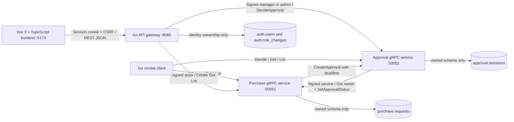
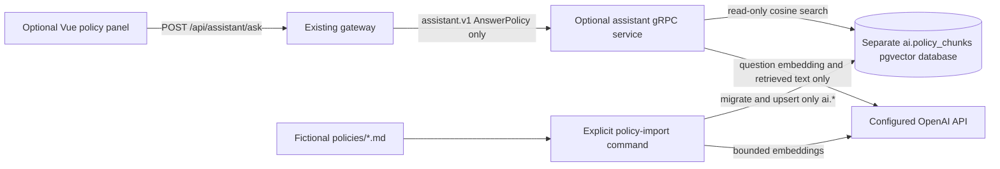
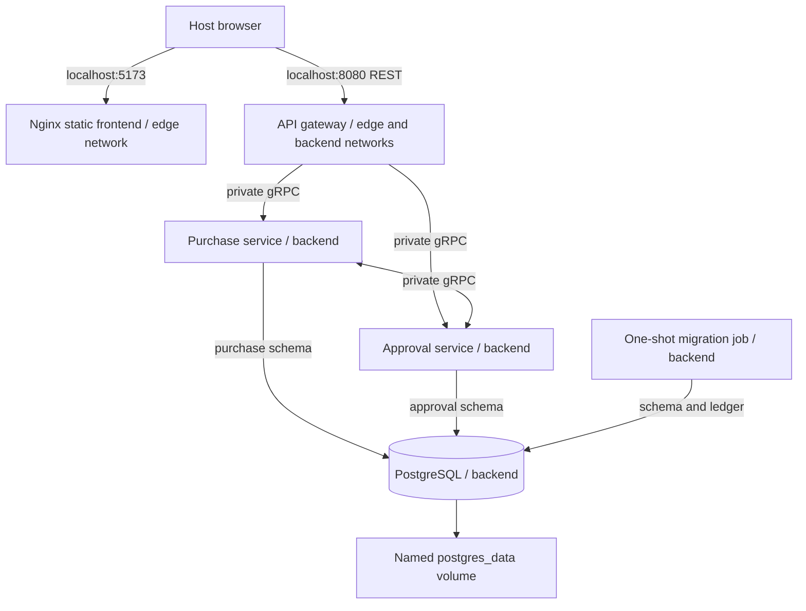

# ProcureFlow AI architecture

## Current implementation: procurement MVP, optional RAG and local authentication

The Vue 3 frontend calls a browser-facing Go REST/JSON gateway, which calls two Go services over gRPC. Each service depends on a context-aware repository interface. Without `DATABASE_URL`, it uses memory; with that variable set, it uses pgxpool and its own PostgreSQL schema. All three backend executables belong to one root Go module. The browser has no database dependency. The gateway identity module connects only to auth.* using AUTH_DATABASE_URL; purchase/approval data is accessed only through gRPC. Domain logic lives in `internal/purchase` and `internal/approval`; `cmd/` contains small entry points. Phase 06 adds local Compose deployment without changing REST or Protocol Buffer contracts.

The procurement schemas and separately owned auth schema share one PostgreSQL instance in Compose. There are no cross-schema queries or foreign keys between service data. The optional Phase 08 assistant uses a separate AI database and does not change procurement contracts. Local authentication and role enforcement are implemented; see [authentication.md](authentication.md). The original `services/` and `api-gateway/` directories remain reserved; current backend code is under `cmd/` and `internal/`.

## Identity ownership and role assignment

Public signup creates employee accounts only; IDs come from the server. Admins
can list users and assign employee, manager or admin through dedicated protected
HTTP routes. Admins inherit manager purchase permissions, including the ban on
self-review. Gateway startup requires migrated, seeded auth storage; there is no
file fallback. Legacy account IDs/hashes are imported once without rewriting
orders, passwords or existing SQL roles.

A Users interface separates context-aware SQL queries from session/HTTP code.
Role changes recheck the actor's admin role in a transaction, serialize with an
advisory lock, protect the last admin, increment a session version, and insert a
role-change audit row atomically. Every authenticated HTTP request reloads the
current version/role; changed sessions are rejected, and database failure fails
closed. Sessions remain in gateway memory and expire on restart. Private signed
gRPC claims last 60 seconds; already-issued claims can remain valid until expiry.
See [authentication.md](authentication.md) for bootstrap and operational limits.

## Optional read-only RAG boundary

Default Compose startup does not start the `assistant` profile. An empty gateway assistant target or missing service credentials/models returns an explicit Not configured result. An unavailable assistant affects only its own HTTP route and never gates procurement startup. No assistant RPC, client, tool, or query can create/approve purchases or retrieve live order data. Future live order lookup needs a separate authenticated design.

The import command applies its own `migrations/assistant/` schema and atomically publishes bounded Markdown chunks with model/dimension metadata. Runtime connections enforce read-only transactions. Questions use the same embedding model/dimension, cosine-distance-filtered top-K retrieval, and only those chunks as LLM evidence. Empty evidence skips generation. Returned citations must identify retrieved source IDs and exact quote substrings; document/section/chunk references come from the service. Fixed instructions treat documents/questions as untrusted and prohibit tools/actions. These controls reduce injection risk but do not guarantee semantic correctness of every generated claim.

The AI database has a separate private network and named volume; provider egress is separate from the procurement backend. The gateway/browser receive no provider secrets or AI database handles. Fake-provider tests exercise real pgvector SQL, gRPC, and source-file provenance; **live OpenAI integration remains unverified without credentials/models**. See [policy-assistant.md](policy-assistant.md) for opt-in commands, privacy, costs, bounds, and verification.

## Local container deployment

Compose publishes only loopback frontend `5173` and gateway `8080`. Nginx serves the production Vue build from container port 8080. Its JavaScript calls the host browser address `http://localhost:8080`; Docker DNS names are used only between containers. The gateway permits the matching `http://localhost:5173` origin. Native service bind defaults remain unchanged; Compose overrides binds to `0.0.0.0` and peer targets to `purchase-service:50051` and `approval-service:50052`.

The internal backend network and unpublished ports keep gRPC/PostgreSQL off host interfaces. The frontend has no backend-network membership; the gateway has only AUTH_DATABASE_URL and queries only auth.*. Startup waits for PostgreSQL TCP readiness, successful migrations, insert-only account bootstrap, and gRPC health before starting the gateway, then HTTP health before starting the frontend. Migrations rerun safely through their existing ledger. Go's small container health command uses the standard gRPC health RPC with a deadline rather than invoking business operations. Health is process readiness, not a guarantee that every dependency remains available.

Go binaries run as a non-root user in small read-only runtime images; the frontend has a separate Node build and unprivileged Nginx runtime. A named volume retains PostgreSQL data when containers are recreated. Public DEVELOPMENT-ONLY credentials come from Compose defaults or ignored `.env`; optional AI configuration is absent. This deployment does not import or delete native database storage. See [docker.md](docker.md) for startup, address differences, and a persistence check.

## Frontend boundary

`frontend/` is a Vite application using Vue's Composition API and TypeScript. `src/lib/api.ts` is the small typed REST client, `src/composables/usePurchases.ts` owns reactive page state, and components provide the request form, status badges, and manual manager review. There is no third-party state-management or UI library. API responses, not sample records, supply all table rows and summary totals.

Decimal EUR input is parsed as text into BigInt cents before being checked against JavaScript's safe-integer range and converted to JSON integer numbers. Multiplication and aggregate formatting avoid floating-point rounding. Unsafe API numbers are rejected visibly rather than silently displayed. The frontend sends an HttpOnly session cookie through credentialed fetch and keeps the CSRF token only in memory. It never stores passwords or bearer tokens in localStorage. `VITE_API_BASE_URL` is public build configuration.

An uncertain create keeps its original idempotency key and payload for identical retries. Decision status changes are applied only after the real gateway confirms success. Refresh replaces the list with fresh API data, and failed refreshes preserve prior rows with a visible stale-data message. Native labels, keyboard focus handling, live notices, text status badges, reduced-motion styles, and a horizontally scrollable semantic table support accessibility.

The current REST purchase response has no creation timestamp, even though PostgreSQL stores one internally. The submitted-date column therefore shows `Not provided`. This phase does not invent dates or change contracts to expose them. Signed-in employee/manager IDs are read-only in forms. Identity is authenticated; manager IDs/comments are not persisted as audit metadata. Frontend tests cover exact cents, API errors, retry identity, form behavior, and dashboard states; opt-in live tests exercise the actual Vue forms against the gateway.

## Boundaries and Go packages

- `internal/purchase` owns purchases, price calculations, create keys, and purchase status transitions.
- `internal/approval` owns approval records and decisions, keyed by purchase ID.
- `internal/domain` defines shared status values, validation helpers, and sentinel errors. It has no gRPC dependency.
- `internal/rpc` translates generated messages into domain inputs and maps domain errors into gRPC status codes. Client adapters implement the small interfaces consumed by the services.
- `internal/gateway` exposes five procurement routes plus the optional policy route using `net/http`, validates JSON, applies CORS/body limits, maps transport errors, and calls generated gRPC clients. It accesses only the identity repository (auth.*); procurement tables remain behind their gRPC services.
- `internal/auth` owns PostgreSQL users, employee-only signup, transactional admin role changes with audit/versioning, bounded in-memory sessions/login throttling, and signed gRPC identity interceptors. No protobuf fields are added for identity.
- `internal/config` reads environment variables and rejects invalid addresses or durations.
- `internal/postgres` manages connection pools and sanitizes database errors; it does not access service tables.
- `migrations/` contains embedded SQL and the migration runner; only `cmd/migrate` performs schema changes.
- `internal/server` supplies structured request logs, health registration, and bounded graceful shutdown.
- `internal/app` wires repositories, services, clients, and handlers together and handles process signals.
- `proto/procureflow/v1/procurement.proto` is the versioned contract; `gen/procureflow/v1` contains generated Go code, never hand-edited.

A Go interface describes the behavior a caller needs. For example, purchase logic needs only `CreateApproval(ctx, purchaseID)`. Unit tests can supply a small fake; the running application supplies a gRPC client adapter. Business logic does not need generated protobuf types or a network connection to be tested.

## Purchase creation and partial failure

1. Validate IDs, item name, positive quantity, and nonnegative unit price.
2. Check `unit_price_cents <= MaxInt64 / quantity` before multiplying. Prices use integer cents, so no floating-point rounding is involved.
3. Atomically insert a PENDING purchase or return the existing record for the same `client_request_id` and identical input. Changed input with the same key returns `AlreadyExists`.
4. Release the repository lock and call `CreateApproval` with a short child-context deadline.
5. Return the current purchase after the call succeeds. A failure leaves the purchase saved and returns a retryable transport error with retry instructions.

An identical create retry uses the same purchase ID and calls the idempotent approval operation again. `CreateApproval` atomically creates at most one record per purchase ID and never resets an existing decision. This repairs a failed handoff or lost response without creating a duplicate. Returned purchase status may already be terminal if a reviewer decided it between calls.

## Approval decisions and synchronization

The HTTP decision endpoint requires a manager or admin session and CSRF token. Supplied `manager_id` must match the session; the Approval Service checks ownership over gRPC and forbids self-review. Manager ID/comment are not persisted by the existing status-only RPC; the response reports `metadata_persisted: false` and `demo_only: false`. There is no chatbot approval integration.

Only PENDING -> APPROVED or PENDING -> REJECTED is allowed. Repeating the same terminal decision is safe; switching to the other terminal decision returns `FailedPrecondition`.

The approval service records the decision locally before calling `SetApprovalStatus` on the purchase service. A failed call does not roll back that decision. Repeating `DecideApproval` with the same ID and status always retries propagation. The purchase service also accepts an identical status update and rejects a conflicting one.

There is no cross-service transaction. During a failure, reads can show a decided approval and a still-PENDING purchase. Recovery depends on the caller retrying the same operation; there is no background queue or reconciliation worker. A timeout is ambiguous: the peer may have completed the write before its response was lost.

## Concurrency and contexts

Memory repositories use `sync.RWMutex` and return value snapshots. PostgreSQL repositories use unique constraints and `INSERT ... ON CONFLICT DO NOTHING` for creates. A separate query reads the committed winner after a duplicate insert; changed input still returns `AlreadyExists`.

Decision updates begin a transaction, read the owned record with `SELECT ... FOR UPDATE`, check its state, update if needed, and commit. The row lock serializes concurrent decisions across processes. Identical decisions do not rewrite timestamps. Transactions and mutexes are released before gRPC calls; a database transaction cannot make two independent service commits atomic.

The database stores UUID primary keys, integer BIGINT cents, and TIMESTAMPTZ audit timestamps. Connections set their time zone to UTC. CHECK constraints reject invalid quantities, amounts, totals, and statuses. `quantity::numeric * unit_price_cents::numeric` validates the total exactly without overflowing during the check; stored monetary values remain integer cents.

`context.Context` carries cancellation and deadlines. Each database operation and service-to-service call derives a bounded child context; an earlier caller deadline still wins. Failed transactions roll back with a short cleanup context even if the request was canceled. The application closes its pool after draining requests. Generated gRPC clients handle Protocol Buffer serialization and transport, while services supply validation and domain decisions.

Both servers expose the standard gRPC health service. Health indicates that the process serves RPCs; it does not assert that the peer is reachable or that all records are synchronized. Shutdown drains requests and falls back to forced cancellation after the configured timeout.

## Intentional limitations

PostgreSQL mode preserves data and idempotency keys across restarts. It still requires the caller to retry failed cross-service synchronization: a durable APPROVED decision may coexist with a PENDING purchase until the identical decision is retried. There is no outbox or background repair worker. Memory mode remains ephemeral. Managers and admins can list all records; employee lists are restricted to their own records. No pagination is implemented. `CreateApproval` validates ID syntax (a UUID in PostgreSQL mode) but does not verify purchase existence; its only authorized caller is the purchase service. Signed service identities restrict internal approval creation and purchase status updates; actor identities cannot invoke those RPCs.

Transport is plaintext for local development. New service processes default to `127.0.0.1:50051` and `127.0.0.1:50052`. Only the gateway exposes browser REST/JSON at `127.0.0.1:8080`, with CORS limited to the configured local Vue origin. CORS does not provide authentication. Schema ownership is enforced by repository query boundaries; production deployment should also grant separate runtime database roles access only to their own schemas.

See [api.md](api.md), [backend.md](backend.md), [postgresql.md](postgresql.md), and [docker.md](docker.md) for commands, migration behavior, and verification.
