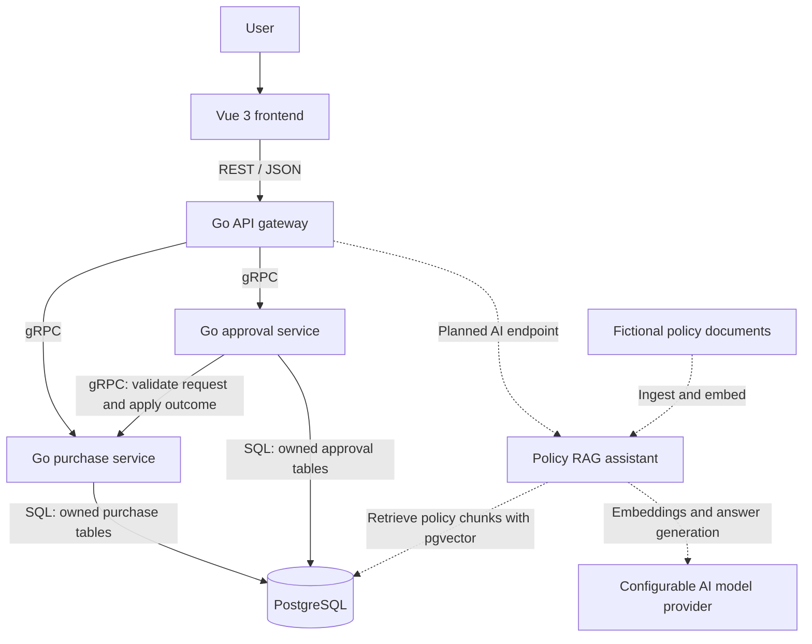

# ProcureFlow AI architecture

## Status and purpose

This document describes the planned architecture. Phase 00 creates repository foundations only; none of the services or data flows below are implemented yet.

ProcureFlow AI separates purchase request management from approval workflows. A Go API gateway gives the Vue frontend a single REST/JSON entry point while Go services communicate through typed gRPC contracts.

## System diagram

The AI component's deployment boundary and provider will be selected during the AI milestone. Dashed connections represent that extension.

## Component responsibilities

### Frontend

`frontend/` will contain the Vue 3 application written in TypeScript and built with Vite. It will provide a dashboard, purchase request forms, approval views, and eventually policy chat. It calls the gateway over HTTP and displays loading, validation, and error states.

### API gateway

`api-gateway/` will expose REST/JSON endpoints. It will decode and validate HTTP requests, call gRPC services with deadlines, and translate service results into consistent HTTP responses. Domain rules remain in the service that owns the behavior.

### Purchase service

`services/purchase-service/` will own purchase request records and their lifecycle. It will validate purchase details, persist requests, and enforce valid status changes, including changes requested by the approval service.

### Approval service

`services/approval-service/` will own approval workflows and decisions. It will consult the purchase service through gRPC and send approval outcomes through an explicit service operation. It will not update purchase tables directly.

### Database and migrations

The initial development environment will use one PostgreSQL instance. Each service owns its tables even though the database infrastructure is shared. Versioned SQL changes will live in `database/migrations/`, with ownership identified when migrations are introduced.

Cross-service calls are not a single database transaction. Before implementing approval-to-purchase updates, define retry behavior, idempotency (repeating an operation without duplicate effects), and recovery from partial failures. A local SQL transaction cannot make two services' updates atomic.

### Policy assistant

The later RAG extension will split fictional policy documents into chunks, create embeddings, and store searchable vectors using PostgreSQL's pgvector extension. For each question, it will retrieve relevant chunks and pass that context to a model to generate an answer with source references. It should acknowledge missing evidence rather than invent policy requirements. Provider configuration and ingestion details are deferred to the AI milestone.

## Go and gRPC concepts

- **Go services:** Each service is a separate process with a focused responsibility. Go module boundaries and executable entry points will be introduced when implementation starts.
- **Protocol Buffers:** `.proto` files in `proto/` define messages and service methods. Numeric field tags identify fields in the binary format, so existing tags must remain stable as contracts evolve.
- **gRPC:** Generated Go client and server code implements the contract's transport layer. Services still need explicit business logic, validation, and error handling. Remote calls can fail or time out even when the caller is healthy.
- **Contexts and deadlines:** A Go `context.Context` carries cancellation and deadlines through a request. Passing it into gRPC and database operations helps stop work when the caller disconnects or a deadline expires.
- **Transport boundaries:** The browser receives JSON from the gateway; internal gRPC calls use Protocol Buffer messages. The gateway translates between these representations.

## Example purchase request flow

1. A user submits a purchase form in Vue.
2. The frontend sends JSON to the gateway.
3. The gateway validates the HTTP input and calls the purchase service over gRPC with a deadline.
4. The purchase service enforces business rules and persists the request in PostgreSQL.
5. The service returns a typed response; the gateway maps it to JSON for the frontend.

## Incremental delivery and verification

Begin with a tested create/get purchase request flow before adding approvals, the gateway, or the frontend. Introduce PostgreSQL and its local Docker Compose configuration when persistence is implemented. Expand Compose as new services are added.

Use Go unit tests for business behavior, integration tests for PostgreSQL and service boundaries, and frontend type/build checks. Keep setup and validation commands aligned with the files that actually exist. All sample records, users, suppliers, and procurement policies must be fictional.
