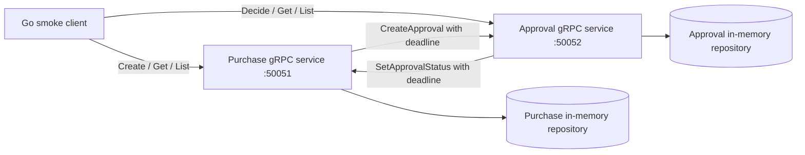

# ProcureFlow AI architecture

## Current implementation: Phase 02

The runnable backend has two Go processes communicating over gRPC, with one in-memory repository per process. Both executables belong to a single root Go module, keeping builds and shared contract generation simple. Domain logic lives in `internal/purchase` and `internal/approval`; `cmd/` contains small entry points.

The future Vue application will call a Go REST/JSON gateway, which will call these services. PostgreSQL, Docker, authentication, and policy RAG are future milestones and have no runtime implementation here. The original `services/` directories remain reserved; current backend code is under `cmd/` and `internal/` as requested.

## Boundaries and Go packages

- `internal/purchase` owns purchases, price calculations, create keys, and purchase status transitions.
- `internal/approval` owns approval records and decisions, keyed by purchase ID.
- `internal/domain` defines shared status values, validation helpers, and sentinel errors. It has no gRPC dependency.
- `internal/rpc` translates generated messages into domain inputs and maps domain errors into gRPC status codes. Client adapters implement the small interfaces consumed by the services.
- `internal/config` reads environment variables and rejects invalid addresses or durations.
- `internal/server` supplies structured request logs, health registration, and bounded graceful shutdown.
- `internal/app` wires repositories, services, clients, and handlers together and handles process signals.
- `proto/procureflow/v1/procurement.proto` is the versioned contract; `gen/procureflow/v1` contains generated Go code, never hand-edited.

A Go interface describes the behavior a caller needs. For example, purchase logic needs only `CreateApproval(ctx, purchaseID)`. Unit tests can supply a small fake; the running application supplies a gRPC client adapter. Business logic does not need generated protobuf types or a network connection to be tested.

## Purchase creation and partial failure

1. Validate IDs, item name, positive quantity, and nonnegative unit price.
2. Check `unit_price_cents <= MaxInt64 / quantity` before multiplying. Prices use integer cents, so no floating-point rounding is involved.
3. Atomically insert a PENDING purchase or return the existing record for the same `client_request_id` and identical input. Changed input with the same key returns `AlreadyExists`.
4. Release the repository lock and call `CreateApproval` with a short child-context deadline.
5. Return the current purchase after the call succeeds. A failure leaves the purchase saved and returns a retryable transport error with retry instructions.

An identical create retry uses the same purchase ID and calls the idempotent approval operation again. `CreateApproval` atomically creates at most one record per purchase ID and never resets an existing decision. This repairs a failed handoff or lost response without creating a duplicate. Returned purchase status may already be terminal if a reviewer decided it between calls.

## Approval decisions and synchronization

Only PENDING -> APPROVED or PENDING -> REJECTED is allowed. Repeating the same terminal decision is safe; switching to the other terminal decision returns `FailedPrecondition`.

The approval service records the decision locally before calling `SetApprovalStatus` on the purchase service. A failed call does not roll back that decision. Repeating `DecideApproval` with the same ID and status always retries propagation. The purchase service also accepts an identical status update and rejects a conflicting one.

There is no cross-service transaction. During a failure, reads can show a decided approval and a still-PENDING purchase. Recovery depends on the caller retrying the same operation; there is no background queue or reconciliation worker. A timeout is ambiguous: the peer may have completed the write before its response was lost.

## Concurrency and contexts

Each repository uses a `sync.RWMutex`. Checks and changes happen within one write lock, so concurrent callers cannot create duplicate records or record conflicting decisions. Get/List return value snapshots rather than mutable pointers into shared maps. No mutex is held during a network call.

`context.Context` carries cancellation and deadlines. Each service-to-service call derives a short child deadline from the incoming context; an earlier caller deadline still wins. Generated gRPC clients handle Protocol Buffer serialization and transport, while services supply validation and domain decisions.

Both servers expose the standard gRPC health service. Health indicates that the process serves RPCs; it does not assert that the peer is reachable or that all records are synchronized. Shutdown drains requests and falls back to forced cancellation after the configured timeout.

## Intentional limitations

Data and idempotency keys live only for the lifetime of each process. Restarting one service loses its records and can break consistency with its peer; restart both to reset this demonstration. Lists return all records sorted by ID with no pagination. `CreateApproval` validates ID syntax but does not verify purchase existence; its intended caller is the purchase service. There is no authorization around internal status operations.

Transport is plaintext for local development. The required default bind addresses (`:50051`, `:50052`) listen on all interfaces; use `127.0.0.1:50051` and `127.0.0.1:50052` to restrict listeners to the local machine. This milestone does not provide production security or durability.

See [backend.md](backend.md) for commands, error behavior, and verification.
